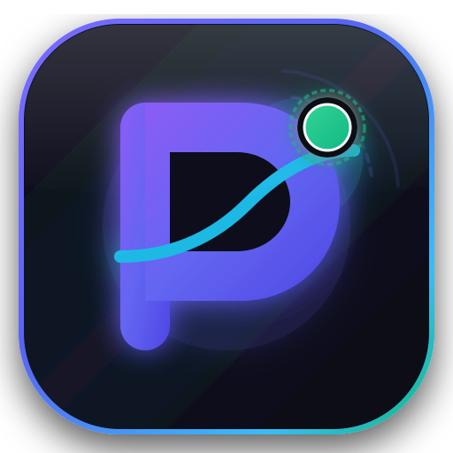
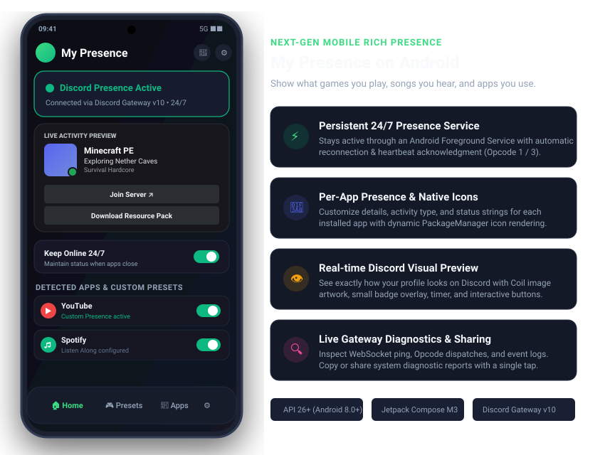
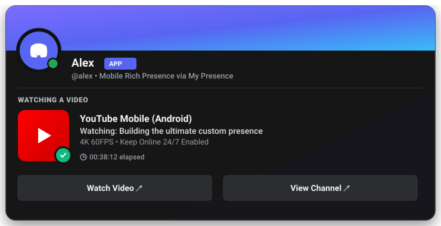

<div align="center">

  

  # My Presence (Android)

  <p>
    <strong>Turn your Android activity into a sleek, living Discord presence.</strong><br>
    <em>Jo Discord detect nahi karta, wo hum detect karwate hain!</em>
  </p>

  <p>
    <a href="https://kotlinlang.org/"></a>
    <a href="https://developer.android.com/jetpack/compose"></a>
    <a href="https://developer.android.com/"></a>
    <a href="https://dagger.dev/hilt/"></a>
    <a href="https://ktor.io/"></a>
    <a href="https://discord.com/developers/docs/topics/gateway"></a>
    
  </p>

  <p>
    <a href="#-the-core-difference">Why My Presence?</a> •
    <a href="#-quick-preview">Preview</a> •
    <a href="#-features">Features</a> •
    <a href="#-how-to-use-step-by-step">How to Use</a> •
    <a href="#-permissions--setup">Permissions</a> •
    <a href="#%EF%B8%8F-architecture">Architecture</a> •
    <a href="#-build-and-run">Build &amp; Run</a> •
    <a href="#-troubleshooting">FAQ</a>
  </p>

</div>

---

> [!IMPORTANT]
> ### 💡 Why My Presence? — Discord Doesn't Detect Mobile Apps, We Do!
> **Spotify is already natively detected by Discord** through your linked Spotify account. But what about everything else?
> - **YouTube & YouTube Music** videos and streams? ❌ *Discord doesn't detect it.*
> - **Mobile Games** (Minecraft PE, BGMI, COD Mobile, Genshin Impact, Roblox)? ❌ *Discord doesn't detect it.*
> - **Streaming Apps** (Netflix, Prime Video, Anime)? ❌ *Discord doesn't detect it.*
> - **Dev & Tools** (Termux, VS Code Web/Acode, Chrome, Notion)? ❌ *Discord doesn't detect it.*
> 
> **That's why My Presence exists.** It automatically detects any application running on your Android device and turns it into a high-fidelity Discord Rich Presence with custom titles, details, state, live elapsed timers, artwork, and clickable buttons!

---

## 📸 Quick Preview

### Actual Android Mobile Interface (Jetpack Compose M3)
<div align="center">
  
</div>

### What Your Friends See On Discord
<div align="center">
  
</div>

---

## ✨ Features

- ⚡ **Automated App Detection for ALL Apps**: Detects foreground applications (YouTube, Netflix, Chrome, Minecraft PE, Genshin Impact, Termux, emulators, etc.) in real-time using `UsageStatsManager`.
- 🎨 **Per-App Customization & Native App Icons**: Tap any installed app card to customize Title, Details, State, and Activity Type (*Playing*, *Streaming*, *Listening*, *Watching*), complete with native dynamic application icons rendered directly from `PackageManager`.
- ⏱️ **Persistent 24/7 Presence Service**: Never drops your Discord presence. Runs continuously via an Android Foreground Service with heartbeat ping maintenance (Opcode 1 / 3) and automatically broadcasts a custom fallback presence when apps close.
- 👁️ **Authentic Discord Visual Card Preview**: Experience a live on-device Discord card preview in both the Dashboard and Presence Editor with Coil artwork, status dots, bold titles, elapsed timers, and interactive action buttons.
- 💾 **Custom Presets Manager**: Create, edit, and apply presence presets on the fly, with starter presets for *Gaming*, *Coding*, and *Music*.
- 🛠️ **Live Gateway Diagnostics & 1-Click Share**: Full connection diagnostics showing WebSocket ping, ACKs, session sequence, and event logs, with one-tap clipboard copy and Android system share sheet.
- 🔋 **Battery-Friendly Background Architecture**: Operates quietly in the background without draining battery, respecting Android Doze mode while ensuring continuous uptime.
- 🚀 **Auto-Start on Boot**: Automatically restores your Discord presence whenever your phone restarts via `BootReceiver`.
- 🌙 **Glassmorphic Dark-First Design**: Custom modern Jetpack Compose Material 3 theme crafted with smooth transitions and glassy UI elements.

---

## 🚀 How to Use (Step-by-Step)

### Step 1: Install & Sign In
1. Download and install the APK on your device running Android 8.0 (API 26) or higher.
2. Launch **My Presence** and complete the quick onboarding walkthrough.
3. Authenticate with Discord to establish a secure connection to the Discord Gateway.

---

### Step 2: Grant Permissions
To automatically detect running apps and keep presence alive in the background:
1. **Usage Access**: Enables the app to see which game or app is in the foreground.
2. **Notification Permission**: Keeps the Android Foreground Service alive so Android doesn't kill the connection.
3. **Battery Optimization Exemption**: Prevents Android from stopping your presence when the screen turns off.

---

### Step 3: Configure Per-App Presences
1. Open the **Apps** screen from the bottom navigation.
2. You'll see a complete list of your installed apps with their native system icons.
3. **Tap any app card** to open the **App Presence Config Dialog**:
   - **Custom Title**: e.g. *"Minecraft PE"* or *"YouTube 4K"*.
   - **Details**: e.g. *"Exploring Nether Caves"* or *"Watching Tech Reviews"*.
   - **State**: e.g. *"Hardcore Survival"* or *"Building Projects"*.
   - **Activity Type**: Pick *Playing*, *Streaming*, *Listening*, *Watching*, or *Auto*.
4. Tap **Save** — whenever you open that app, your Discord status updates instantly!

---

### Step 4: Keep Online 24/7 Mode
Want your Discord status to stay active even when your screen is locked or no supported app is open?
1. Open **Settings** ➔ **General**.
2. Toggle on **Keep online 24/7**.
3. Now, whenever you leave an app, My Presence smoothly displays your default custom presence rather than clearing your status!

---

### Step 5: Custom Presets & Studio Editor
1. Tap **Presets** in the bottom navigation.
2. Select any starter preset (*Gaming Session*, *Deep Coding Work*, *Lo-Fi Beats*) or tap **+** to build your own.
3. Tap **Edit** to open the full **Presence Editor**, where you can fine-tune hover text, live timestamps, artwork links, and Discord buttons.
4. Changes sync reactively to Discord in real time!

---

## 🔒 Permissions & Privacy

| Permission | Purpose |
|:---|:---|
| `PACKAGE_USAGE_STATS` | Detects foreground games and apps to trigger presence |
| `FOREGROUND_SERVICE` | Keeps the WebSocket connection alive 24/7 |
| `RECEIVE_BOOT_COMPLETED` | Restores your presence service on phone reboot |
| `REQUEST_IGNORE_BATTERY_OPTIMIZATIONS` | Prevents Android Doze mode from dropping Discord presence |
| `POST_NOTIFICATIONS` | Displays the persistent foreground notification required by Android |

*Note: My Presence never collects personal chats, passwords, or keystrokes. App detection only reads the package name of the active foreground window.*

---

## 🏗️ Architecture

```mermaid
flowchart TD
    subgraph UI ["Jetpack Compose UI (Material 3)"]
        Dashboard[Dashboard Screen]
        Editor[Presence Editor Screen]
        Presets[Custom Presets Screen]
        Apps[Installed Apps Screen]
        Diag[Diagnostics Screen]
    end

    subgraph Service ["Android Background Engine"]
        PS[PresenceService (Foreground)]
        AD[AppDetector (UsageStatsManager)]
        BR[BootReceiver]
    end

    subgraph Core ["Data & Gateway Core"]
        PR[PreferencesRepository (DataStore)]
        AR[AppRepository]
        DGE[DiscordGatewayEngine (Ktor WebSocket)]
    end

    subgraph Discord ["Discord Cloud Infrastructure"]
        GW["Discord Gateway v10<br>(wss://gateway.discord.gg)"]
    end

    Dashboard --> PS
    Editor --> PR
    Apps --> AR
    AD -->|Foreground App Changed| PS
    PS -->|Build Activity Payload| DGE
    PR -->|Reactively Observe Presets & Settings| PS
    DGE -->|Heartbeat & Opcode 3 Dispatch| GW
    GW -->|ACK / Event Stream| DGE
    DGE -->|Live Logs & Sequence State| Diag
    BR -->|Reboot Event| PS
```

---

## 🛠️ Build and Run

### Prerequisites
- [Android Studio Ladybug (2024.2+)](https://developer.android.com/studio) or newer
- JDK 17+
- Android SDK 35 (API 35, Min SDK 26)

### Clone & Build Setup

```bash
# Clone the repository
git clone https://github.com/Legendscene/My-Presence-Android.git
cd My-Presence-Android

# Configure secrets.properties (in the project root)
cat > secrets.properties << 'EOF'
DISCORD_CLIENT_ID=your_discord_client_id
GOOGLE_WEB_CLIENT_ID=your_google_client_id
DISCORD_BOT_TOKEN=your_bot_token
IMGUR_CLIENT_ID=your_imgur_client_id
EOF
```

### Build Commands

```bash
# Verify Kotlin compilation
./gradlew compileDebugKotlin

# Run unit tests
./gradlew testDebugUnitTest

# Assemble debug APK
./gradlew assembleDebug

# Build release bundle
./gradlew bundleRelease
```

---

## ❓ Troubleshooting & FAQ

<details>
<summary><strong>My presence turns off when I lock my phone. How do I fix this?</strong></summary>

1. Ensure **Keep online 24/7** is enabled in Settings.
2. In your device's System Settings, navigate to **Battery** ➔ **My Presence** and set battery usage to **Unrestricted** (disables battery optimization kills).
3. On Xiaomi/MIUI, enable **Autostart**; on Samsung, remove My Presence from "Sleeping Apps".
</details>

<details>
<summary><strong>Why isn't a specific app triggering presence?</strong></summary>

1. Navigate to the **Apps** screen and make sure the app toggle is turned on.
2. Verify that **Usage Access** permission is granted in Android Settings.
3. Check **Diagnostics** to verify that foreground events are registering.
</details>

<details>
<summary><strong>How do I report connection errors or bugs?</strong></summary>

Open **Settings** ➔ **Diagnostics**, tap the **Copy** or **Share** icon at the top right, and paste your diagnostic report into our Discord or GitHub Issues!
</details>

---

## 👥 Authors & Community

- **Pranay Prajapati**
  - Portfolio: [pranayprajapati.netlify.app](https://pranayprajapati.netlify.app/)
  - GitHub: [@Legendscene](https://github.com/Legendscene)
  - Discord: `1189590421307924562`

- **Arnav Badola**
  - Portfolio: [arnavbadola.vercel.app](https://arnavbadola.vercel.app)
  - GitHub: [@theycallmearnav](https://github.com/theycallmearnav)
  - Discord: `1374981345880707122`

---

<div align="center">
  <sub>Built with ❤️ using Kotlin, Jetpack Compose, and Discord Gateway v10.</sub>
</div>
